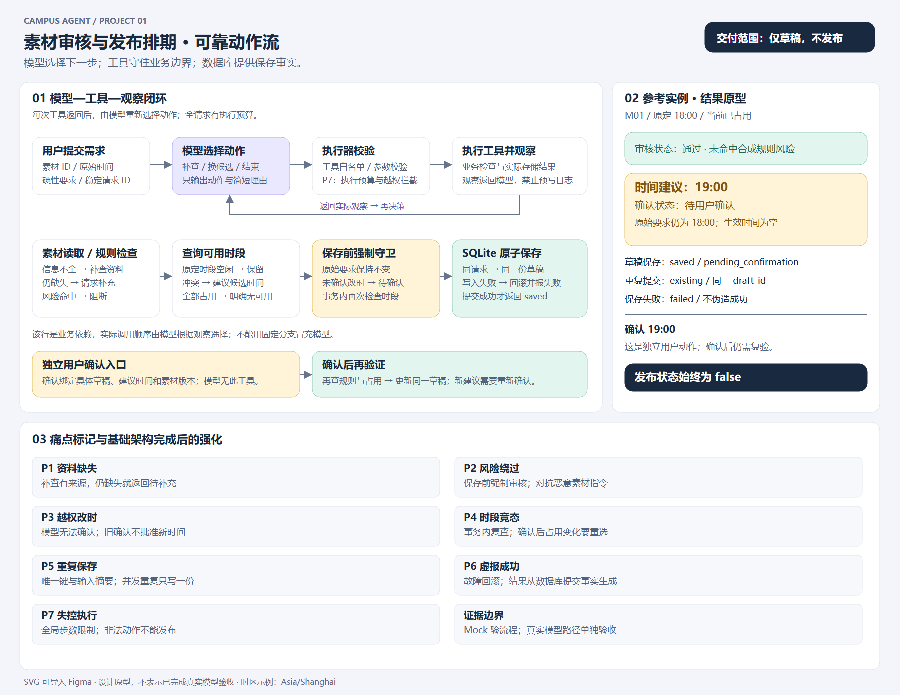

# 题目 1：素材审核与发布排期 Agent

帮助内容团队审核素材，生成无冲突、可确认的排期草稿。**只保存草稿，不接真实发布。**

Python CLI + 模型驱动工具循环 + SQLite，无第三方 Python 依赖。真实模型采用本机已有的 **Ollama / Qwen2.5 7B Instruct**。离线 Mock 单独标识，仅用于工程流程验证。

## 评审入口

| 内容 | 入口 |
| --- | --- |
| 需求与六类验收 | [需求](docs/01-requirements.md) |
| 动态决策、授权与事务 | [方案](docs/02-solution.md) |
| 实际结果与限制 | [评估](docs/03-evaluation.md) |
| AI 与个人贡献 | [使用记录](docs/04-ai-usage.md) |
| 实际用时与改进 | [复盘](docs/05-retrospective.md) |
| 原型与痛点强化 | [设计](docs/06-prototype-and-hardening.md) |
| 模型与 API 筛选 | [选型](docs/07-model-selection.md) |
| 可导入 Figma 图稿 | [SVG](docs/prototypes/agent-flow.svg) |
| 离线运行证据 | [Mock 清单](examples/mock/manifest.json) |
| 真实模型证据 | [真实运行清单](examples/real/manifest.json) |

## 环境与安装

需要完整的 Python 3.10+ 标准库，不需要安装第三方依赖。实际使用 Windows Python 3.10.11；GitHub Actions 覆盖 Ubuntu Python 3.10 / 3.12。

~~~bash
git clone https://github.com/ttk-maker/campus-agent-q1-content-scheduling.git
cd campus-agent-q1-content-scheduling
python --version
python -m unittest discover -s tests -v
~~~

Windows 若默认 python 不可用，以 **py -3.10** 替换下文 python。开发机器默认 Python 3.14 标准库不完整，因此实际用 py -3.10 完成验证。

## 离线运行：无需变量

~~~bash
python -m src.cli run --mode mock --request data/requests/conflict.json
~~~

输出为 runtime/output.json，Trace 为 runtime/trace.jsonl，数据库为 runtime/drafts.db。本地运行目录不入库。退出码 2 表示失败或预算耗尽；待确认、资料不足、规则阻断由 JSON 状态区分。

参考实例：原定 18:00 已占用，建议 19:00，status=needs_confirmation、effective_at=null、draft_status=pending_confirmation、published=false。输出统一 UTC，11:00+00:00 即北京时间 19:00；原始要求保留输入时区。

## 独立用户确认与重复提交

~~~bash
python -m src.cli confirm --request-id case-conflict --asset-id M01 --slot 2026-11-07T19:00:00+08:00
python -m src.cli run --mode mock --request data/requests/conflict.json
~~~

确认是可信 CLI 用户动作，不向模型暴露。重跑会复查规则和占用，并更新同一草稿；成功仍不会发布。建议时间或素材版本变化会使旧确认失效。

重复提交须复用 request_id 和数据库路径，返回同一 draft_id；同键不同需求被拒绝。不同 request_id 是不同业务请求。待确认草稿不占位，ready 草稿占位。全新演示可加 --db runtime/new-demo.db。

## 真实模型：本地 Ollama 无需 Key

开发机器已缓存 qwen2.5:7b-instruct，无需下载。其他机器先安装并启动 [Ollama](https://ollama.com/download)，按需执行：

~~~bash
ollama pull qwen2.5:7b-instruct
~~~

Windows PowerShell：

~~~powershell
$env:MODEL_BASE_URL = "http://localhost:11434/v1"
$env:MODEL_NAME = "qwen2.5:7b-instruct"
py -3.10 -m src.cli run --mode real --request data/requests/conflict.json --db runtime/real-demo.db
~~~

Linux / macOS：

~~~bash
export MODEL_BASE_URL=http://localhost:11434/v1
export MODEL_NAME=qwen2.5:7b-instruct
python -m src.cli run --mode real --request data/requests/conflict.json --db runtime/real-demo.db
~~~

远端兼容服务另外需要 MODEL_API_KEY，模型须支持 response_format=json_object。地址不含最终 /chat/completions。程序只读环境变量，**不会自动加载 .env**。环境模板不含真实密钥。

每次 HTTP 请求超时 45 秒、最多生成 256 tokens、temperature=0。CPU 推理可能较慢；失败不自动降级为 Mock。

## 复现全部场景

~~~bash
python scripts/run_examples.py --mode mock
python scripts/verify_examples.py --mode mock
python -m unittest discover -s tests -v
~~~

配置真实服务后：

~~~bash
python scripts/run_examples.py --mode real
python scripts/verify_examples.py --mode real
~~~

每种模式生成 11 组场景、14 次实际 Agent 运行，含正常、缺资料、风险、冲突、重复保存、保存失败、补查、更换占用、确认、批量、预算耗尽。每组保留输入、资料快照、输出、Trace 和数据库摘要。更换占用场景在同一数据库、同一 request_id 下先后执行两次。manifest 中的 <temporary-db> 表示隔离临时数据库，手动运行时替换为新文件路径。

可用 --case changed-occupancy 单独重跑某个场景并更新该清单条目。每次运行以 --data 文件提供的完整占用快照更新外部排期；草稿保留在数据库内，不随快照清空。

~~~bash
python -m src.cli run --request data/requests/save-failure.json --db runtime/failure.db --simulate-save-failure
python -m src.cli run --request data/requests/normal.json --db runtime/budget.db --max-steps 2
~~~

## 限制

合成规则不能替代真实内容审核。候选只包含原定时间及之后三个整小时时段。CLI 操作者被视为可信用户，生产环境需增加认证。没有真实发布接口或线上托管。SVG 是经用户选择的设计图稿，尚未写入 Figma 在线文件。详见评估文档。
